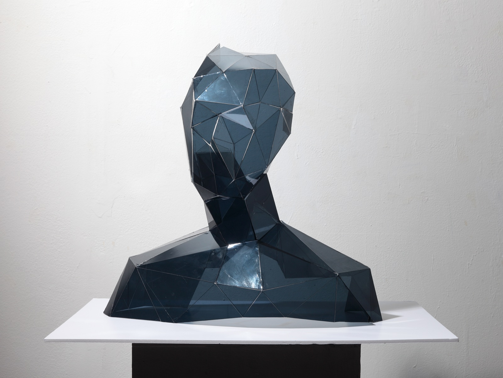
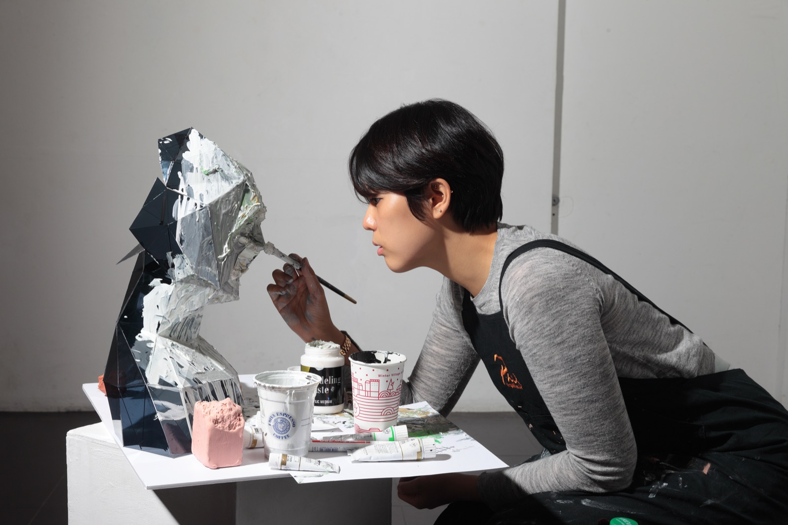
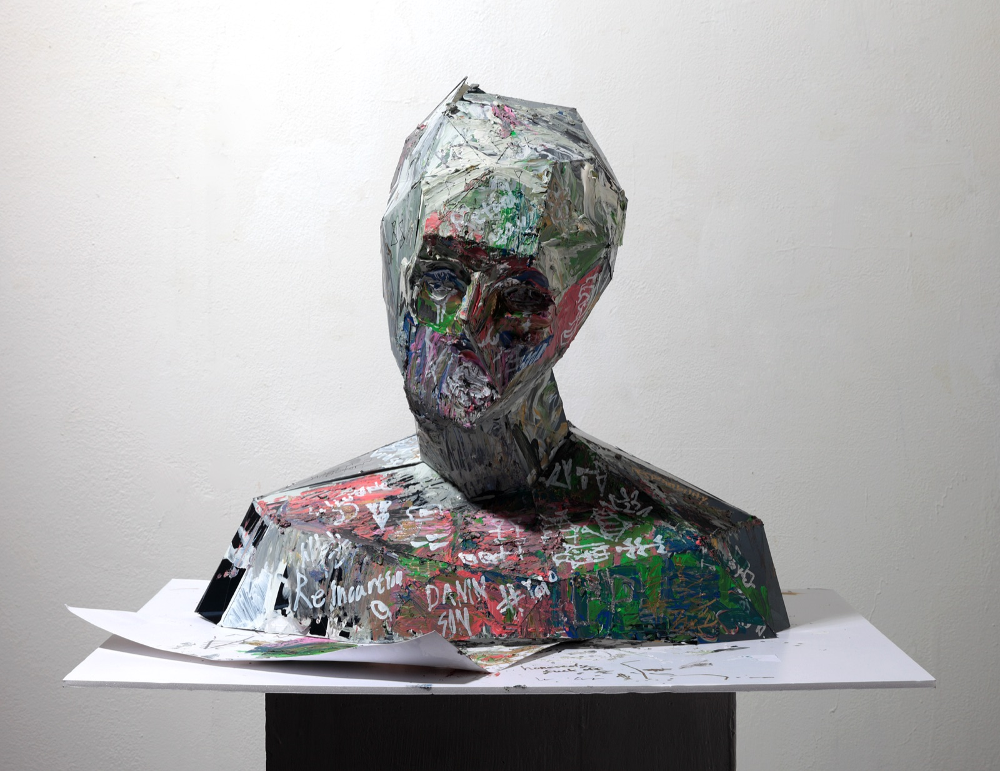

# Misunderstood

Misunderstood is a media installation and a short film about the distance between a person and the way others see them. I built a faceted acrylic torso and asked people to draw on it, then filmed them from the inside, looking out through the surface they were covering.

From inside, each person starts out clearly visible. As the marks pile up, their face breaks apart behind the lines, until the view closes off completely. The torso never changes; only the surface between inside and outside does. The piece is about the unavoidable misunderstanding between what someone is and how they are defined from the outside: any reflection of the self has to pass through a surface, and that surface distorts it.

<iframe style="position:absolute;top:0;left:0;width:100%;height:100%;" src="https://www.youtube.com/embed/His3b5PdBZs" frameborder="0" allow="accelerometer; autoplay; clipboard-write; encrypted-media; gyroscope; picture-in-picture" allowfullscreen></iframe>

 

*Media installation and film (01:14), 1m x 0.5m x 0.5m*

## From the Inside

Stills from the film, in order. The camera sits inside the torso while people draw on it from the outside.

## Process

The torso started as a low-poly 3D model. I unfolded it into a flat net with Pepakura, used the printed net as a template to cut acrylic panels, and joined the panels by hand into the finished form.

Once the clean faceted form was assembled, the drawing began, one person after another adding marks over the last until the original surface was almost lost beneath them.

The finished piece carries both states at once: the quiet form underneath, and the noise of everything put onto it.

